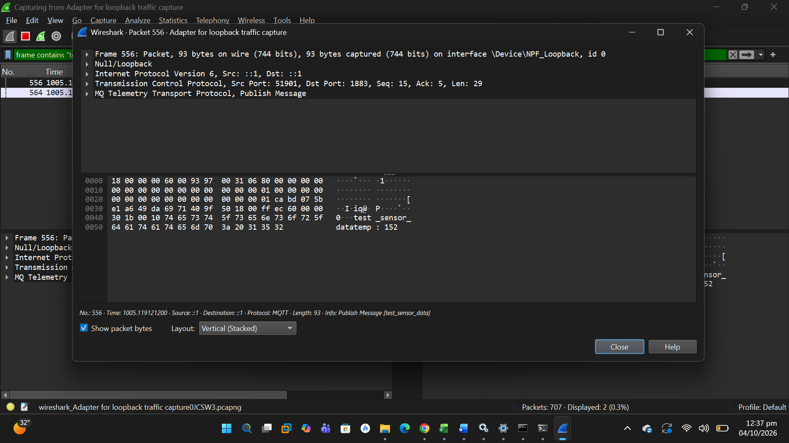
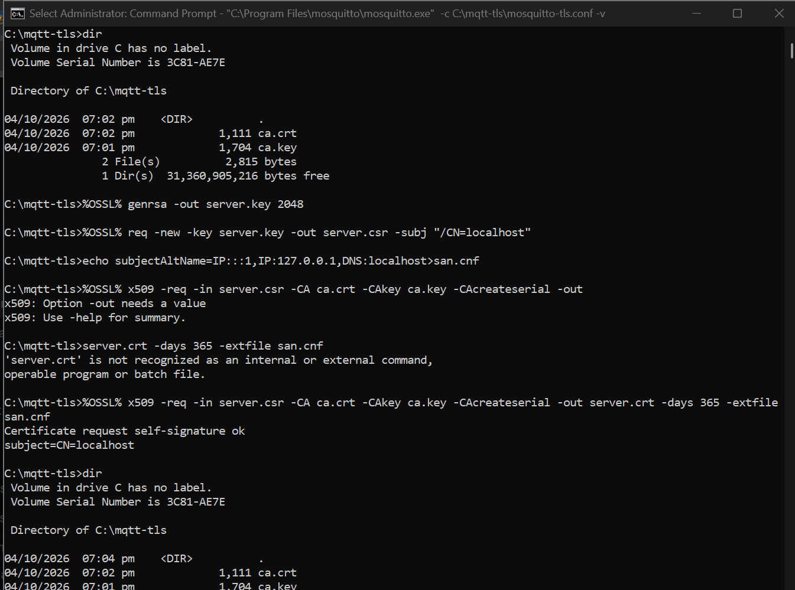
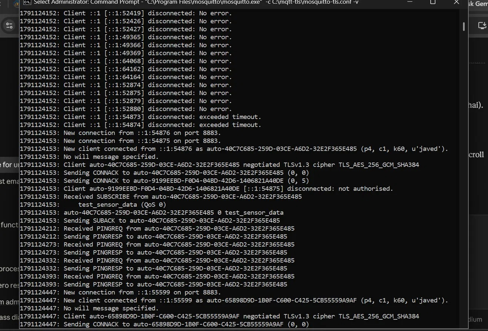
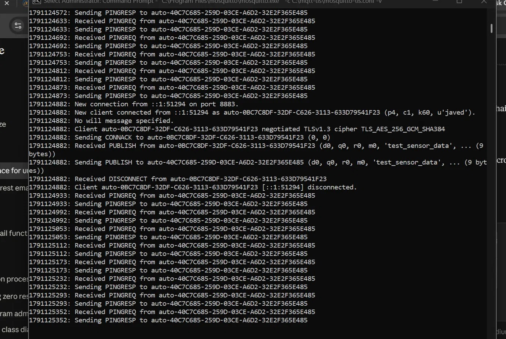
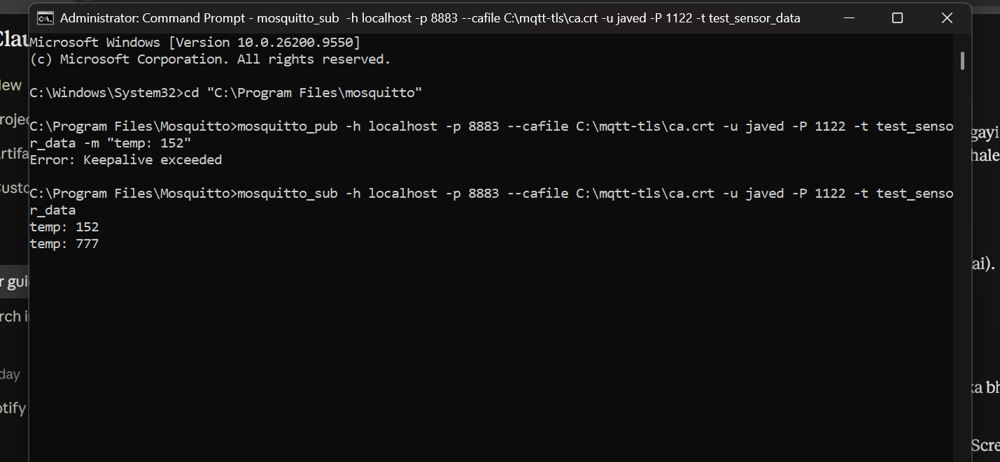
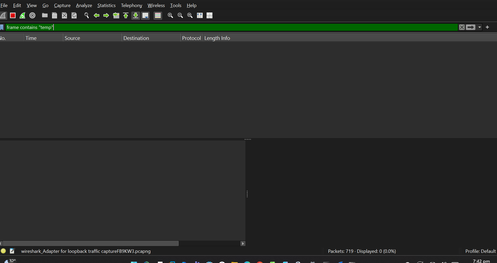

# Secure IoT Communication: MQTT over TLS 1.3

A hands-on lab that shows **why plain MQTT is unsafe** and **how TLS 1.3 + authentication fixes it**, using a local Mosquitto broker, OpenSSL and Wireshark.

**Author:** Javed Ali, BE Software Engineering (QUEST, 2026)
**Focus:** Network & IoT Security

---

## 1. Problem

IoT devices (sensors, smart meters, etc.) commonly send data using **MQTT**. By default MQTT runs on port **1883 with no encryption and no login**. Anyone on the same network can read the messages with a packet sniffer, or publish fake data.

## 2. What I did

| Phase | Goal | Result |
|---|---|---|
| Phase 1 | Run MQTT without security and capture traffic | Sensor data readable in plain text in Wireshark |
| Phase 2 | Enable TLS 1.3 with a private CA, plus username/password | Traffic encrypted; wrong or missing credentials rejected |

## 3. Lab setup

- Windows 11 laptop
- Eclipse Mosquitto 2.1.2 (broker + `mosquitto_pub` / `mosquitto_sub`)
- Wireshark 4.6.9 with Npcap (loopback capture)
- OpenSSL 3.5.8 (certificates)
- Topic used: `test_sensor_data`

## 4. Phase 1: Plain MQTT (insecure)

Broker on port 1883, no encryption, no authentication. A test message was published and captured in Wireshark.

**Finding:** the topic name and the payload are visible in clear text inside the packet.



Capture file: [`phase1/mqtt_plain.pcapng`](phase1/mqtt_plain.pcapng)

## 5. Phase 2: MQTT over TLS 1.3 (secure)

### 5.1 Certificates (OpenSSL)
1. Created a private Certificate Authority (CA).
2. Created a server key and certificate request for `localhost`.
3. Signed the server certificate with the CA, including a Subject Alternative Name (`IP:::1, IP:127.0.0.1, DNS:localhost`).



### 5.2 Broker configuration

See [`phase2/mosquitto-tls.conf`](phase2/mosquitto-tls.conf):

- TLS listener on port **8883**
- CA, server certificate and server key configured
- `allow_anonymous false`, so a username and password are required

### 5.3 Results

**Encrypted session:** the broker log shows TLS 1.3 negotiated with `TLS_AES_256_GCM_SHA384`, an authenticated client, and a rejected client (`not authorised`).



**Message delivery:** the broker received and forwarded the publish over TLS.



**Subscriber received the data:**



**Wireshark: no plaintext:** the capture shows only TLSv1.3 Application Data. Searching for the word `temp` in the packets returned **0 matches**.



Capture file: [`phase2/mqtt_tls.pcapng`](phase2/mqtt_tls.pcapng)

## 6. Before vs After

| | Plain MQTT (1883) | MQTT + TLS 1.3 (8883) |
|---|---|---|
| Payload visible to sniffer | Yes | No |
| Authentication | None | Username + password |
| Server identity checked | No | Yes (CA-signed certificate) |
| Unauthorised client | Accepted | Rejected |

## 7. Key learnings

- Why unencrypted IoT protocols leak data on shared networks
- How a private CA and server certificate (with SAN) are built
- How TLS 1.3 and broker authentication are configured in Mosquitto
- How to verify security claims with packet captures instead of assumptions

## 8. Limitations and next steps

- Tested on a single machine (localhost); a real deployment needs a separate broker and devices.
- Username/password only. Next: per-device client certificates (mutual TLS) and topic-level ACLs.
- Test password was a throwaway lab value.

## 9. Security note

Private keys (`ca.key`, `server.key`), the password file and signing files are **intentionally not included** in this repository. Only the public CA certificate (`ca.crt`) and the broker config are shared.

## 10. Folder structure

```
secure-iot-mqtt/
├── README.md
├── phase1/   plain MQTT screenshot + capture
└── phase2/   TLS screenshots, capture, ca.crt, broker config
```
